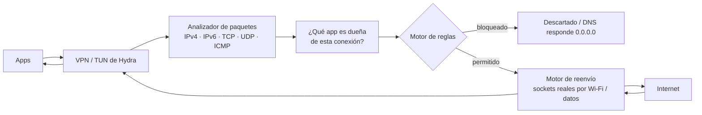

# Hydra Firewall

**Un firewall por app para Android 7.0+. Sin root. Sin cuenta. Sin telemetría.**

[](https://github.com/hydraroot/Hydra_Firewall/actions/workflows/android.yml)


🇬🇧 [English version](README.md)

<p align="center">
  
  
  
  
</p>

> **Estado: candidata para prueba cerrada** (`1.0.0`, versionCode `164`). Probala primero con apps no críticas.
> **Hydra es un firewall, no un antivirus.** Leé [Lo que Hydra NO hace](#lo-que-hydra-no-hace) antes de confiar en ella.

---

## Resumen

Hydra funciona como una **VPN local en tu teléfono**. Todo paquete que mandan tus apps pasa primero por
Hydra, y Hydra decide —app por app, y por separado para Wi‑Fi y datos móviles— si puede salir del
dispositivo. Además filtra anuncios, rastreadores y dominios/IP maliciosos, y te muestra con quién habla
cada app y por qué.

Todo ocurre **en el dispositivo**. No hay servidores de Hydra, ni cuenta, ni analíticas.

| | |
|---|---|
| **Qué es** | Un firewall para Android construido sobre el `VpnService` del sistema (interfaz TUN). Código abierto, GPL‑3.0‑or‑later. |
| **Qué hace** | Reglas por app para Wi‑Fi/datos · aviso en la primera conexión · cuarentena opcional de apps nuevas · bloqueo de dominios de anuncios/rastreadores/malware · DNS cifrado · filtrado SNI/JA3/QUIC sin descifrar HTTPS · reglas de IP y puertos · pack de amenazas firmado · escáner de APK y puntaje de riesgo · análisis de comportamiento local · historial y estadísticas · bloqueo con PIN/huella · exportar/importar configuración |
| **Qué no hace** | Detectar malware de forma confiable · descifrar HTTPS · reemplazar la seguridad de Android · bloquear el tráfico de apps que excluiste de la VPN · funcionar junto con otra VPN |
| **Privacidad** | Sin telemetría. Las únicas conexiones que Hydra hace por su cuenta están en [Actualizaciones y actividad de red](#actualizaciones-y-actividad-de-red). |
| **Requisitos** | Android 7.0+ (API 24). Android permite una sola VPN activa a la vez. |
| **Costo / licencia** | Gratis. GPL‑3.0‑or‑later. Los datos y librerías de terceros están en [Componentes de terceros](#componentes-de-terceros-y-licencias). |

## Índice

1. [Cómo funciona](#cómo-funciona)
2. [Funciones](#funciones)
3. [Qué hace la IA incorporada](#qué-hace-la-ia-incorporada)
4. [Actualizaciones y actividad de red](#actualizaciones-y-actividad-de-red)
5. [Lo que Hydra NO hace](#lo-que-hydra-no-hace)
6. [Inicio rápido](#inicio-rápido)
7. [Instalar o compilar](#instalar-o-compilar)
8. [Preguntas frecuentes](#preguntas-frecuentes)
9. [Índice de documentación](#índice-de-documentación)
10. [Componentes de terceros y licencias](#componentes-de-terceros-y-licencias)
11. [Marca, seguridad, contribuciones y licencia](#marca-seguridad-contribuciones-y-licencia)

## Cómo funciona

Android deja que una app cree una interfaz VPN sin root. Hydra crea una, le pide a Android que enrute el
tráfico del teléfono hacia ella y luego implementa su propia pila de red en espacio de usuario.



1. **Captura.** Android manda a la interfaz TUN de Hydra el tráfico de toda app que no esté excluida.
2. **Identificación.** Hydra averigua qué app es dueña de cada conexión (API del sistema en Android nuevo, `/proc/net` en Android 7–9). Si no puede saberlo, la conexión se descarta: nunca adivina.
3. **Decisión.** El motor de reglas combina la regla de la app, el tipo de red (Wi‑Fi / datos), el modo global, los horarios, las reglas de IP y puertos, las coincidencias de DNS/SNI/JA3 y el pack de amenazas.
4. **Reenviar o descartar.** El tráfico permitido se reenvía por sockets reales atados a la red física; las respuestas se reconstruyen como paquetes IP y se devuelven a la app.

Una explicación más detallada (enrutamiento, DNS, inspección TLS/QUIC, límites) está en
[`docs/HOW-IT-WORKS.md`](docs/HOW-IT-WORKS.md) (en inglés).

## Funciones

Resumen corto. Cada función está explicada en detalle en [`docs/FEATURES.md`](docs/FEATURES.md) (en inglés).

### Controlar quién puede conectarse
- **Reglas por app** para Wi‑Fi y datos móviles por separado: *Permitir*, *Bloquear*, *Permisivo*, *Personalizado* y *Sin firewall*.
- **Aviso de primera conexión.** Las apps nuevas arrancan bloqueadas y Hydra te pregunta: permitir, permitir 10 minutos, 1 hora, siempre o bloquear. La vista *Detalles* explica por qué se está conectando la app.
- **Cuarentena de apps nuevas** (opcional, **desactivada por defecto**; se activa en *Seguridad → Cuarentena*). Las apps instaladas *después* de activarla quedan sin red hasta que las revisás, y Hydra muestra su puntaje de riesgo. Las apps que ya estaban en el teléfono no se ven afectadas. Sirve sobre todo si dejás que las apps nuevas se conecten por defecto; con la configuración por defecto (las apps nuevas arrancan bloqueadas y preguntan) es redundante.
- **Modo global** (lista negra o lista blanca), decisión por defecto para Wi‑Fi/datos, horarios, reglas de roaming y pantalla apagada, y un interruptor de emergencia **Bloquear todo**.
- **Bloqueo de IP y reglas de puertos** (modo avanzado) por protocolo, dirección y puerto.

### Filtrar a qué se conectan
- **Bloqueo de dominios de anuncios/rastreadores/malware** con una lista incluida en el APK (~18.000 dominios) más listas en vivo opcionales (HaGeZi, 1Hosts, StevenBlack, OISD).
- **DNS cifrado** por DNS‑sobre‑TLS (con respaldo DNS‑sobre‑HTTPS) usando Cloudflare, Google o Quad9.
- **Filtrado HTTPS por nombre del servidor (SNI)** y por **huella TLS (JA3)**, sin descifrar nada.
- **Filtrado QUIC / HTTP3** con mejor esfuerzo, correlacionando con la respuesta DNS que esa misma app obtuvo antes.
- **Controles de red local e IPv6**, incluido un interruptor *Bloquear IPv6*.
- **Pack de inteligencia de amenazas firmado** (IP/dominios maliciosos de fuentes como Feodo Tracker y URLhaus, más reglas YARA‑Lite). Se instala solo si su firma se verifica.

### Entender tus apps
- **Historial de conexiones y analizador en vivo**: app, destino, protocolo, puerto, decisión y hora.
- **Consumo por app**: ranking de tráfico (sesión / hoy / 7 días) con banderas como "sube más de lo que baja".
- **Escáner de APK y puntaje APP RISK** (0–100): permisos, componentes exportados, accesibilidad/superposición/administrador de dispositivo, librerías nativas, certificados de firma.
- **Motor de comportamiento**: correlaciona conexiones, DNS y bloqueos en un puntaje de comportamiento por app, usando solo metadatos que Hydra ya ve.
- **Modelos en el dispositivo** (uno pequeño entrenado con MH‑100K y dos modelos heurísticos livianos) usados solo como *señales secundarias* que avisan: nunca bloquean por sí solos. Ver [Qué hace la IA incorporada](#qué-hace-la-ia-incorporada).
- **Etiquetas de seguridad de apps del sistema** (riesgo alto / precaución / indeterminado) antes de bloquear un componente del sistema.
- **Autotest y diagnóstico** para comprobar el manejo de DNS, SNI, TCP e ICMP en tu equipo.

### Proteger a Hydra misma
- **PIN de 5 a 8 dígitos** (PBKDF2, 120.000 iteraciones) y desbloqueo con **huella**. Los intentos fallidos agregan esperas crecientes (de 15 s hasta 5 min) que sobreviven a reinicios y no se pueden acortar cambiando el reloj del teléfono. Los PIN de 4 dígitos creados por versiones anteriores siguen funcionando hasta que los cambies. `allowBackup=false`.
- **Monitoreo de manipulación y recuperación**: paradas inesperadas, comportamiento de Doze, conflictos de reglas, reinicio tras el arranque.
- **Exportar/importar configuración** (reglas, horarios, reglas avanzadas, excepciones de IP) como un archivo portable por nombre de app, con deshacer automático.
- **Modo Normal y Avanzado**, interfaz en español/inglés, tema claro/oscuro, opciones de batería.

## Qué hace la IA incorporada

Hydra incluye tres modelos muy pequeños que se ejecutan **por completo en tu teléfono** (sin nube; ningún dato sale del dispositivo). Ninguno puede bloquear una app ni cambiar una regla: solo agregan un **puntaje de advertencia** que ves en el Centro de seguridad y en el detalle de cada app.

| Modelo | Qué mira | Qué obtenés |
|---|---|---|
| **Modelo estático de APK (MH‑100K)** | Un APK que escaneás: permisos, llamadas a la API e intents que aparecen en su código | Un puntaje de 0 a 100 de "se parece a malware Android conocido". La precisión es de solo ~64 % con umbral 0,5 y marca como sospechosas al 5,6 % de las apps legítimas, así que tomalo como una pista. |
| **Modelo de comportamiento ("AI Lite")** | Metadatos de conexión por app: cantidad de destinos, bloqueos de DNS, puertos inusuales, alertas TLS, ráfagas | Un nivel de riesgo de comportamiento. Se entrenó con datos sintéticos, por lo que **no** es evidencia de detección real. |
| **Modelo de privacidad** | Comportamiento tipo rastreador por app: muchos destinos nuevos, consultas DNS bloqueadas, bloqueos SNI | Una señal de privacidad/rastreo. Nunca etiqueta una app como malware. |

Junto con las reglas YARA‑Lite, el pack de amenazas firmado y la línea base de comportamiento por app (se aprende localmente cuando activás el registro de tráfico), alimentan el **Centro de seguridad** para que decidas con más información. La decisión siempre es tuya.

## Actualizaciones y actividad de red

Hydra **no tiene telemetría** y **no se actualiza sola**: las versiones nuevas de la app las instalás vos
manualmente. Las únicas conexiones que la app hace por su cuenta son:

| Qué | Cuándo | A dónde |
|---|---|---|
| **Pack de amenazas firmado** | Automáticamente cada ~24 h (alarma inexacta), o a pedido con *Actualizar ahora* en el Centro de seguridad. La compilación por defecto apunta a la rama `threat-pack` de este repositorio. | `raw.githubusercontent.com` |
| **Listas de dominios** | Solo cuando **vos** tocás *Actualizar listas* / *Buscar actualización* en la pantalla de listas. | GitHub raw (HaGeZi, 1Hosts, StevenBlack) y, si lo activás, `big.oisd.nl` |
| **DNS cifrado** | De forma continua, para resolver nombres. | Cloudflare / Google / Quad9 (a tu elección) |

Cómo se protege el pack de amenazas:

- Se acepta **solo si su firma ECDSA P‑256 / SHA‑256 se verifica** con la clave pública compilada en la app; los packs alterados se descartan.
- El feed debe usar `https://` y las descargas están limitadas a 20 MB.
- Las descargas van por la **red física** (fuera del túnel de Hydra) para que una regla de bloqueo no pueda impedir la actualización.
- Los packs publicados por el workflow vencen a los 14 días; un pack vencido se ignora y se usa el incluido. El pack incluido en el APK es solo una semilla mínima (sin vencimiento y casi sin indicadores): la protección real viene del pack descargado.
- Podés verificar un pack publicado vos mismo: `python tools/verify_threat_pack.py <archivo o URL>`.

Las listas se descargan directamente de sus autores a tu teléfono; Hydra no las replica
(ver [`THIRD_PARTY_NOTICES.md`](THIRD_PARTY_NOTICES.md)).

Permisos que pide la app:

| Permiso | Para qué |
|---|---|
| `INTERNET`, `ACCESS_NETWORK_STATE` | Reenviar el tráfico permitido, actualizar el pack de amenazas, distinguir Wi‑Fi de datos móviles |
| `FOREGROUND_SERVICE`, `FOREGROUND_SERVICE_SYSTEM_EXEMPTED` | Mantener vivo el servicio VPN con su notificación |
| `QUERY_ALL_PACKAGES` | Listar las apps instaladas (nombres e íconos) para aplicar reglas por app |
| `PACKAGE_USAGE_STATS` | Solo estadísticas de uso locales |
| `POST_NOTIFICATIONS` | Avisos de primera conexión y alertas |
| `RECEIVE_BOOT_COMPLETED` | Reiniciar la protección cuando el teléfono arranca |
| `USE_BIOMETRIC`, `USE_FINGERPRINT` | Desbloqueo con huella |

## Lo que Hydra NO hace

- **No es un antivirus.** El escáner de APK es estático y heurístico. El modelo MH‑100K es una señal
  secundaria: con umbral 0,5 su propio informe muestra ~64 % de precisión y 5,6 % de falsos positivos
  en apps legítimas. El modelo "AI Lite" se entrenó con datos sintéticos y no es evidencia de detección real.
- **No descifra HTTPS.** El filtrado es por nombre de dominio (SNI) o por IP. Las apps con DoH propio,
  ECH o IP fijas pueden saltearse el filtrado por dominio. QUIC/HTTP3 se cubre solo de forma indirecta.
- **"Bloquear todo" no es un kill switch completo.** Bloquea el tráfico que entra al túnel de Hydra.
  Hydra misma y las apps configuradas como *Sin firewall* / excluidas (modo compatibilidad) quedan fuera
  del túnel y no se bloquean. Para un corte total usá *VPN siempre activa* + *Bloquear conexiones sin VPN* de Android.
- **El PIN protege la pantalla de Hydra, no el teléfono.** Alguien con root, ADB o acceso a los Ajustes de Android igual puede detener la VPN o borrar los datos de Hydra sin el PIN. Para más protección usá el bloqueo de pantalla de Android y *VPN siempre activa* + *Bloquear conexiones sin VPN*.
- **Una sola VPN a la vez** (limitación de Android). El malware con privilegios de root/sistema puede ignorar la VPN.
- **Rendimiento:** el reenvío corre en espacio de usuario, así que esperá más consumo de batería y algo de
  latencia que con un firewall nativo. Límite nominal de 768 sesiones simultáneas (TCP 128+128, UDP 256+256).
  IPv6 no tiene paridad total (se rechazan ESP y cabeceras de extensión no soportadas).
- **Android 7–9** identifican la app dueña mediante `/proc/net`, que puede fallar de forma transitoria; esas
  conexiones se descartan (*falla cerrada*) y se vuelven a resolver en segundo plano.
- **Las apps excluidas son invisibles para Hydra.** No puede ver ni filtrar el tráfico que nunca entra al túnel.
- **Las apps nuevas arrancan bloqueadas**, así que vas a tener que aprobarlas la primera vez que se conecten.

Lista completa: [`docs/es/LIMITATIONS.md`](docs/es/LIMITATIONS.md).

Dos filas del Centro de seguridad arrancan legítimamente en cero en una instalación nueva: **"Inteligencia
de amenazas (0 dominios)"** (hasta que actualizás las listas con la fuente HaGeZi Threat Intelligence
activada) y **"Aprendizaje local de comportamiento (0 apps)"** (hasta que activás el registro de tráfico
en la pestaña Analizador y reabrís el Centro de seguridad tras algo de uso real).

## Inicio rápido

1. **Instalá** el APK (ver abajo) y abrí Hydra.
2. Tocá el interruptor **Firewall VPN** en la pestaña PROTECCIÓN y aceptá el aviso de VPN de Android.
3. Permití las notificaciones y excluí a Hydra de la optimización de batería (si no, Android puede detener el servicio).
4. Usá el teléfono normalmente. Cada app que se conecta por primera vez muestra el **aviso de primera conexión**: elegí *Permitir*, *Bloquear* o *Detalles* para ver por qué se conecta.
5. Abrí **REGLAS** para revisar los interruptores Wi‑Fi/datos por app, **CONEXIONES** para ver el historial y **SEGURIDAD** para el pack de amenazas y el escaneo de apps.
6. Opcional: poné un **PIN** (5 a 8 dígitos), activá **VPN siempre activa** en los ajustes de Android, activá la **Cuarentena** si querés revisar las apps nuevas y corré el **Autotest** (modo Avanzado) para validar DNS/SNI/TCP en tu teléfono.

Antes de reinstalar Hydra, usá **Exportar** (Ajustes/Perfiles) para guardar tu configuración y **Importar** después.

## Instalar o compilar

**¿Solo querés probarla?** Descargá el APK desde la página de [Releases](https://github.com/hydraroot/Hydra_Firewall/releases).
Puede que debas permitir "instalar apps desconocidas" y que Play Protect avise porque la app se distribuye
fuera de Play Store. Verificá el SHA‑256 que figura en las notas de la versión.

**Compilar desde el código** — JDK 17 y el Android SDK (o Android Studio). Guía completa: [`docs/es/BUILD.md`](docs/es/BUILD.md).

```bash
./build.sh install      # tests + APK debug + instalación por adb
./build.sh release      # APK release (firmada si configuraste keystore)
```

En Windows: `BUILD-AND-INSTALL.ps1`. GitHub Actions (`.github/workflows/`) compila y testea en cada push.

> El ID de aplicación de esta versión para Google Play es `com.hydra.firewall`, igual al de la app creada en Play Console. Mantenelo sin cambios en futuras actualizaciones. Las compilaciones locales anteriores con `com.hydraroot.firewall` o `com.example.firewall` se tratan como apps distintas; exportá tu configuración desde una versión anterior antes de cambiar e importala en esta.
>
> Los APK debug compilados por GitHub Actions se firman con una clave temporal que cambia en cada ejecución. Para actualizar sobre una instalación existente tenés que desinstalar primero (exportá tu configuración antes), o usar un keystore de release; ver `docs/es/BUILD.md`.

## Preguntas frecuentes

**¿Hydra ve mi tráfico?** Ve metadatos de los paquetes (app, IP de destino, puerto, nombres DNS, nombre del servidor TLS) para aplicar las reglas. No descifra HTTPS y no sube nada.

**¿Por qué una app se quedó de repente sin internet?** Las apps nuevas arrancan bloqueadas. Abrí **CONEXIONES** para ver qué se bloqueó y por qué, y revisá la regla de la app, los interruptores Wi‑Fi/datos, los horarios y los ajustes globales.

**¿Por qué una app con *Sin firewall* igual se conecta durante Bloquear todo?** Las apps fuera del túnel no las ve Hydra. Ver la limitación de arriba.

**¿Puedo usar Hydra con otra VPN?** No. Android permite una sola VPN activa.

**¿Gasta batería?** El reenvío en espacio de usuario consume más que un firewall nativo. Hay opciones de bajo consumo en Ajustes.

**¿La IA es un detector de malware?** No. Los modelos en el dispositivo son señales secundarias que avisan; nunca bloquean automáticamente. Ver [Qué hace la IA incorporada](#qué-hace-la-ia-incorporada).

**¿Para qué sirve la cuarentena?** Para que una app recién instalada no tenga red hasta que la revises. Es opcional y viene desactivada; se activa en *Seguridad → Cuarentena*.

**¿Cómo sé que un pack de amenazas es genuino?** La app verifica una firma ECDSA antes de instalarlo. Vos mismo podés verificarlo con `tools/verify_threat_pack.py`.

**¿Qué pasa si me olvido el PIN?** El PIN solo protege la pantalla de Hydra y no se exporta. Si lo olvidás, borrá los datos de la app desde los Ajustes de Android (vas a perder tu configuración, así que exportala de vez en cuando).

## Índice de documentación

| Documento | Qué cubre |
|---|---|
| [`docs/FEATURES.md`](docs/FEATURES.md) (inglés) | Cada función explicada en detalle |
| [`docs/HOW-IT-WORKS.md`](docs/HOW-IT-WORKS.md) (inglés) | Arquitectura: enrutamiento, pipeline de paquetes, DNS, TLS/QUIC, límites |
| [`docs/es/LIMITATIONS.md`](docs/es/LIMITATIONS.md) | Qué garantiza y qué no garantiza Hydra |
| [`docs/es/THREAT-PACK.md`](docs/es/THREAT-PACK.md) | Packs de amenazas firmados: claves, feeds, verificación |
| [`docs/es/BUILD.md`](docs/es/BUILD.md) | Compilar, firmar e instalar; respaldo de claves; migración |
| [`docs/es/SECURITY.md`](docs/es/SECURITY.md) / [`SECURITY.md`](SECURITY.md) | Cómo reportar una vulnerabilidad |
| [`docs/es/CONTRIBUTING.md`](docs/es/CONTRIBUTING.md) / [`CONTRIBUTING.md`](CONTRIBUTING.md) | Cómo contribuir |
| [`TRADEMARK.es.md`](TRADEMARK.es.md) | Uso de los nombres y el logo de Hydra Firewall / Hydraroot |
| [`CHANGELOG.md`](CHANGELOG.md) | Historial de versiones |
| [`THIRD_PARTY_NOTICES.md`](THIRD_PARTY_NOTICES.md) | Datos, librerías y licencias de terceros |

## Componentes de terceros y licencias

Hydra es **GPL‑3.0‑or‑later** (ver [`LICENSE`](LICENSE)). Se apoya en lo siguiente; los detalles completos,
atribuciones y exclusiones están en [`THIRD_PARTY_NOTICES.md`](THIRD_PARTY_NOTICES.md).

**Librerías (enlazadas en el APK)**

| Componente | Licencia |
|---|---|
| Kotlin / Kotlin stdlib | Apache‑2.0 |
| AndroidX (core‑ktx, activity‑compose, lifecycle, fragment, appcompat, biometric) | Apache‑2.0 |
| Jetpack Compose (BOM, ui, material3, foundation) | Apache‑2.0 |
| kotlinx.coroutines | Apache‑2.0 |
| JUnit 4, org.json (solo tests, no se distribuyen) | EPL‑1.0 / dominio público |

**Datos incluidos dentro del APK**

| Datos | Licencia / autor |
|---|---|
| Lista de anuncios/rastreadores: lista ad-hoc de Steven Black, FadeMind hosts.extras, Badd‑Boyz‑Hosts, hostsVN | MIT |
| Lista de anuncios/rastreadores: AdAway (© Kicelo, Dominik Schuermann y colaboradores), Tiuxo hostlist | CC BY 3.0 / CC BY 4.0 — requiere atribución |
| Lista de anuncios/rastreadores: minecraft‑hosts | CC0‑1.0 |
| Certificados raíz públicos (DigiCert Global Root CA, DigiCert Global Root G2, ISRG Root X1, ISRG Root YR), usados solo como respaldo adicional para actualizaciones HTTPS en Android viejo | Certificados públicos de CA |
| Modelo en el dispositivo entrenado con el **MH‑100K Android Malware Dataset** (hendriow/mh100k); el dataset en sí no se incluye | CC BY 4.0 — ver [`docs/reference/MH100K-ATTRIBUTION.md`](docs/reference/MH100K-ATTRIBUTION.md) |

**Datos que el teléfono descarga a pedido tuyo (no se redistribuyen en el APK)**

| Fuente | Licencia |
|---|---|
| HaGeZi Multi PRO mini, HaGeZi Threat Intelligence mini | GPL‑3.0 |
| 1Hosts Lite | MPL‑2.0 |
| StevenBlack unified hosts (opcional) | MIT (agrega fuentes con sus propios términos) |
| OISD (opcional) | términos a confirmar antes de usar |
| abuse.ch — Feodo Tracker, URLhaus, ThreatFox (a través del pack firmado) | CC0 |

**Servicios usados:** resolvedores DNS cifrados de Cloudflare, Google y Quad9 (operados por esas
empresas bajo sus propios términos y políticas de privacidad).

Esta sección es un resumen de buena fe, no asesoramiento legal. Las marcas pertenecen a sus dueños.

## Marca, seguridad, contribuciones y licencia

- **Marca.** El código es software libre (GPL‑3.0‑or‑later) y cualquiera puede hacer un fork. Los **nombres «Hydra Firewall» y «Hydraroot» y el logo no se licencian junto con el código**. Si publicás una versión modificada, usá otro nombre, otro logo y otro `applicationId`, y no la presentes como la app oficial. Ver [`TRADEMARK.es.md`](TRADEMARK.es.md).
- ¿Encontraste una vulnerabilidad? Por favor **no abras un issue público**: ver [`docs/es/SECURITY.md`](docs/es/SECURITY.md).
- ¿Querés contribuir? Ver [`docs/es/CONTRIBUTING.md`](docs/es/CONTRIBUTING.md).
- GPL‑3.0‑or‑later © 2026 Hydraroot / WDS657. Ver [`LICENSE`](LICENSE).
