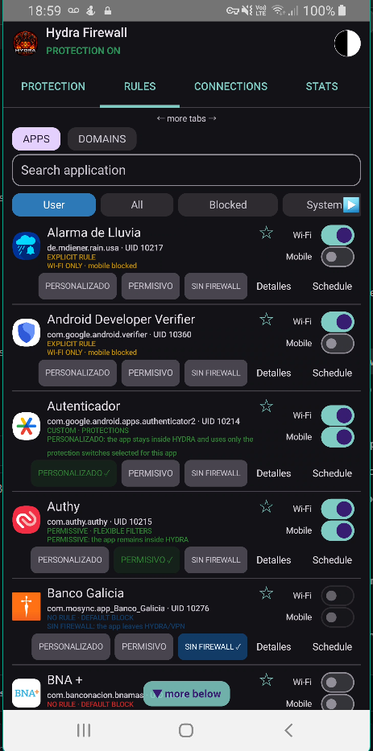

# Hydra Firewall

**Per-app firewall for Android 7.0+ — no root, no accounts, no telemetry.**

Hydra runs as a **local VPN** on your phone. All traffic passes through the app, which decides
which apps may reach the internet (separately for Wi‑Fi and mobile data) and filters ads,
trackers and known-malicious domains/IPs. Everything runs on-device; there are no Hydra servers.

🇪🇸 [Versión en español](README.es.md)

> **Status: beta** (`1.5-beta6-final-r13-fix174`). Try it first with non-critical apps.
> **Hydra is a firewall, not an antivirus.** Read [What Hydra does NOT do](#what-hydra-does-not-do)
> and [`docs/LIMITATIONS.md`](docs/LIMITATIONS.md) before relying on it.

<!-- Screenshots: put 2–4 images in docs/img/ and link them here, e.g.
 -->

---

## What Hydra does

| Feature | Details |
|---|---|
| **Per-app rules** | Allow / Block / Essential / No firewall / Custom, with Wi‑Fi and mobile data set independently; schedules and advanced rules (ports/destinations) |
| **First-connection prompt** | Newly seen apps start **blocked** and Hydra asks (allow, 10 min, 1 h, always, block). Wi‑Fi and mobile start ON when you allow |
| **Quarantine** | Newly installed apps wait for your review |
| **DNS filtering** | ~18,000 ad/tracker domains bundled in the APK (permissive/CC0/CC BY sources only); optional live lists: HaGeZi, 1Hosts, StevenBlack, OISD |
| **Encrypted DNS** | DoH/DoT via Cloudflare, Google or Quad9 |
| **TLS inspection without decryption** | Blocks by server name (SNI) and JA3 fingerprint — HTTPS is never decrypted |
| **QUIC / HTTP3** | Best effort: correlates with the DNS answer the same app resolved earlier |
| **Threat intelligence** | Signed pack of malicious IPs/domains/YARA‑Lite rules (e.g. Feodo Tracker, URLhaus) — see [`docs/THREAT-PACK.md`](docs/THREAT-PACK.md) |
| **Local behavior learning** | Per-app traffic profile learned on the phone, no cloud. Needs traffic recording enabled in the Analyzer tab (off by default) |
| **APK scanner** | Static analysis (permissions, exported components, DEX) + YARA‑Lite rules + a small on-device model (MH‑100K) as a *secondary* signal that warns, never auto-blocks |
| **"Why is it connecting?"** | Resolved domain, list/threat-intel matches, port meaning, install source and app age — in the prompt and history detail |
| **Usage insights** | Per-app traffic ranking (session / today / 7 days) with flags like "uploads more than downloads"; stored only on the phone |
| **App protection** | PIN (PBKDF2) with attempt limiting, fingerprint unlock, `allowBackup=false` |
| **Backup** | Export/import rules, lists and settings (portable by app name, not UID) |
| **Diagnostics** | History, per-app/per-destination stats, self-test, threat-pack status screen |
| **Protocols** | IPv4 and IPv6 TCP/UDP forwarding, ICMP/ICMPv6, IPv6 fragment reassembly, optional "Block IPv6" switch |

## Updates and network activity

Hydra has **no telemetry** and **does not update itself** (no auto-update of the APK — you install
new versions manually). The only connections the app makes on its own are:

| What | When | Where |
|---|---|---|
| **Signed threat pack** | Automatically about once every 24 h (if a feed URL is compiled in; default points to this repo's `threat-pack` branch), or on demand with *Update now* in Security Center | `raw.githubusercontent.com` |
| **Domain blocklists** | Only when **you** tap *Update lists* / *Check for update* in the blocklist screen | GitHub raw (HaGeZi, 1Hosts, StevenBlack), `big.oisd.nl` (optional) |
| **Encrypted DNS** | Continuously, for resolving names | Cloudflare / Google / Quad9 (your choice) |

The threat pack is accepted **only if its ECDSA P‑256 / SHA‑256 signature verifies** against the
public key compiled into the app; tampered packs are discarded. Expired packs are ignored and the
bundled one is used instead. Lists are downloaded straight from their authors to your phone — Hydra
does not mirror them (see [`THIRD_PARTY_NOTICES.md`](THIRD_PARTY_NOTICES.md)).

Sensitive permissions: `INTERNET`, `FOREGROUND_SERVICE`, `QUERY_ALL_PACKAGES` (app names/icons),
`PACKAGE_USAGE_STATS` (local stats), `POST_NOTIFICATIONS`, `RECEIVE_BOOT_COMPLETED`, biometrics.

## What Hydra does NOT do

- **It is not an antivirus.** The APK scanner is static and heuristic. The MH‑100K model is a
  secondary signal: at threshold 0.5 its own report shows ~64 % precision and 5.6 % false positives
  on legitimate apps. The "AI Lite" model was trained on synthetic data and is not evidence of real
  detection.
- **It does not decrypt HTTPS.** Filtering is by domain name (SNI) or IP. Apps with their own DoH,
  ECH, or hard-coded IPs can bypass domain filtering. QUIC/HTTP3 is covered only indirectly.
- **"Block all" is not a full kill switch.** It blocks traffic that enters Hydra's tunnel. Hydra
  itself and apps set to *No firewall* / excluded (compatibility mode) stay outside the tunnel and
  are not blocked. For a hard cutoff use Android's *Always-on VPN* + *Block connections without VPN*.
- **Only one VPN at a time** (Android limitation). Malware with root/system privileges can ignore
  the VPN.
- **Performance:** forwarding runs in user space, so expect more battery use and some latency
  compared with a native firewall. Nominal limit of 768 concurrent sessions (TCP 128+128,
  UDP 256+256). IPv6 does not have full parity (ESP and unsupported extension headers are rejected).
- **Android 7–9** identify the owning app through `/proc/net`, which can fail transiently; such
  connections are dropped (*fail closed*) and re-resolved in the background.
- **Local-only guarantees:** the firewall cannot see traffic of apps excluded from the VPN, nor
  traffic that never reaches the tunnel.
- New apps start blocked, so expect to approve apps the first time they connect.

Two Security Center rows legitimately start at zero on a fresh install: **"Threat intelligence
(0 domains)"** (until you update lists with the HaGeZi Threat Intelligence source enabled) and
**"Local behavior learning (0 apps)"** (until you enable traffic recording).

## Install / build

Requirements: JDK 17 and the Android SDK (or Android Studio). Full guide: [`docs/BUILD.md`](docs/BUILD.md).

```bash
./build.sh install      # tests + debug APK + adb install
./build.sh release      # release APK (signed if you configured a keystore)
```

Windows: `BUILD-AND-INSTALL.ps1`. GitHub Actions (`.github/workflows/`) builds and tests on every push.

> The application ID is `com.hydraroot.firewall` (formerly `com.example.firewall`); Android treats it
> as a different app. **Export your settings from the old version first.**

## Project layout

```
app/                           Kotlin + Jetpack Compose app
  src/main/java/.../vpn/         Network engine: TCP/UDP/ICMP forwarding, DNS, rules
  src/main/java/.../security/    APK scanner, YARA‑Lite, models, signed threat packs
tools/                         Model training and signed threat-pack generator (Python)
docs/                          Guides (BUILD, THREAT-PACK, LIMITATIONS), references, history
third_party/licenses/          License texts
```

## Security

Found a vulnerability? Please **do not open a public issue** — see [`SECURITY.md`](SECURITY.md).

## Third-party components and licenses

Hydra itself is **GPL‑3.0‑or‑later** (see [`LICENSE`](LICENSE)). It builds on the following; full
details, attribution and exclusions are in [`THIRD_PARTY_NOTICES.md`](THIRD_PARTY_NOTICES.md).

**Libraries (linked into the APK)**

| Component | License |
|---|---|
| Kotlin / Kotlin stdlib | Apache‑2.0 |
| AndroidX (core‑ktx, activity‑compose, lifecycle, fragment, appcompat, biometric) | Apache‑2.0 |
| Jetpack Compose (BOM, ui, material3, foundation) | Apache‑2.0 |
| kotlinx.coroutines | Apache‑2.0 |
| JUnit 4 (tests only, not shipped) | EPL‑1.0 |

**Data bundled inside the APK**

| Data | License / author |
|---|---|
| Ad/tracker blocklist: Steven Black ad-hoc list, FadeMind hosts.extras, Badd‑Boyz‑Hosts, hostsVN | MIT |
| Ad/tracker blocklist: AdAway (© Kicelo, Dominik Schuermann and contributors), Tiuxo hostlist | CC BY 3.0 / CC BY 4.0 — attribution required |
| Ad/tracker blocklist: minecraft‑hosts | CC0‑1.0 |
| Public root CA certificates (DigiCert Global Root CA, DigiCert Global Root G2, ISRG Root X1, ISRG Root YR) used only as an additive fallback for HTTPS updates on old Android | CA public certificates |
| On-device model trained from the **MH‑100K Android Malware Dataset** (hendriow/mh100k) — the dataset itself is not bundled | CC BY 4.0 — see [`docs/reference/MH100K-ATTRIBUTION.md`](docs/reference/MH100K-ATTRIBUTION.md) |

**Data downloaded by the phone at your request (not redistributed in the APK)**

| Source | License |
|---|---|
| HaGeZi Multi PRO mini, HaGeZi Threat Intelligence mini | GPL‑3.0 |
| 1Hosts Lite | MPL-2.0 (per the upstream repository metadata) |
| StevenBlack unified hosts (optional) | MIT (aggregates sources with their own terms) |
| OISD (optional) | terms to confirm before use |
| abuse.ch — Feodo Tracker, URLhaus, ThreatFox (through the signed pack) | CC0 |

**Services used:** Cloudflare, Google and Quad9 encrypted DNS resolvers (operated by those
companies under their own terms and privacy policies).

This section is a good-faith summary, not legal advice. Trademarks belong to their owners.

## Contributing

See [`CONTRIBUTING.md`](CONTRIBUTING.md). Changes are recorded in [`CHANGELOG.md`](CHANGELOG.md).

## License

GPL‑3.0‑or‑later © 2026 Hydraroot / WDS657. See [`LICENSE`](LICENSE).
