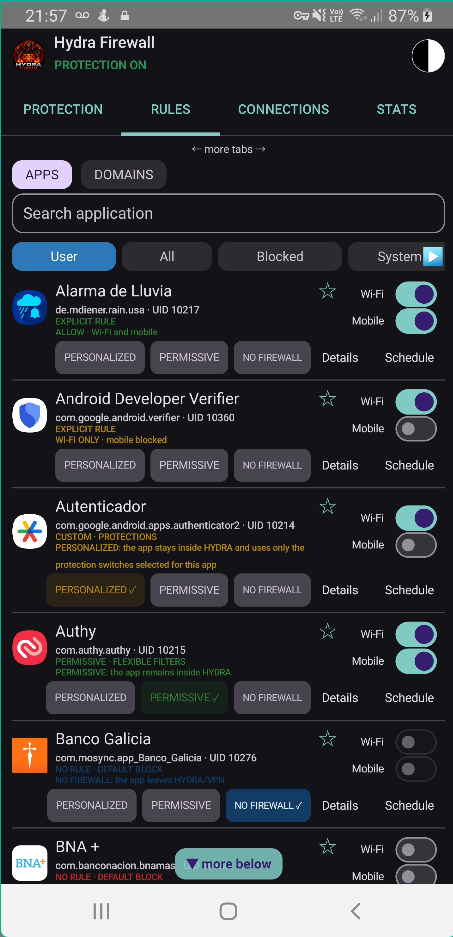
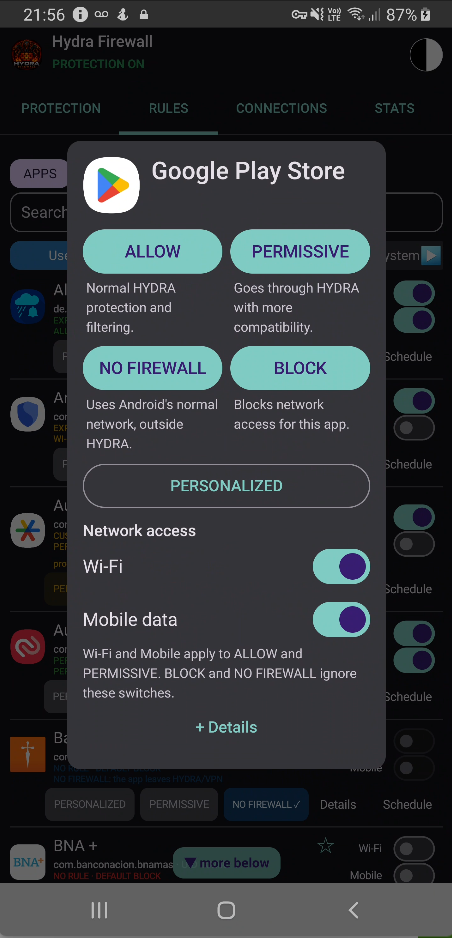
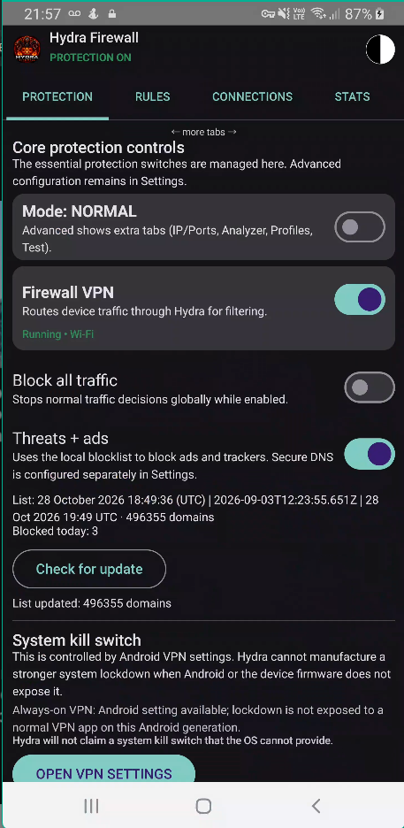
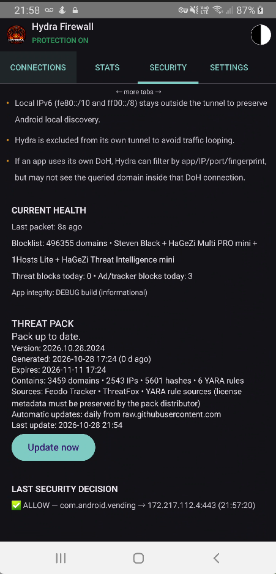
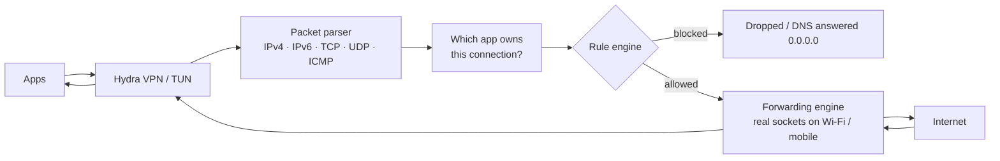

# Hydra Firewall

**A per-app firewall for Android 7.0+. No root. No account. No telemetry.**

[](https://github.com/hydraroot/Hydra_Firewall/actions/workflows/android.yml)


🇪🇸 [Versión en español](README.es.md)

<p align="center">
  
  
  
  
</p>

> **Status: closed-testing candidate** (`1.0.0`, versionCode `164`). Try it first with non-critical apps.
> **Hydra is a firewall, not an antivirus.** Read [What Hydra does NOT do](#what-hydra-does-not-do) before relying on it.

---

## Summary

Hydra runs as a **local VPN on your phone**. Every packet your apps send goes through Hydra first,
and Hydra decides — per app, and separately for Wi‑Fi and mobile data — whether it may leave the
device. On top of that it filters ads, trackers and known-malicious domains/IPs, and gives you
visibility into what each app is talking to and why.

Everything runs **on the device**. There are no Hydra servers, no account and no analytics.

| | |
|---|---|
| **What it is** | An Android firewall built on the system `VpnService` (TUN interface). Open source, GPL‑3.0‑or‑later. |
| **What it does** | Per-app Wi‑Fi/mobile rules · first-connection prompts · new-app quarantine · ad/tracker/malware domain blocking · encrypted DNS · SNI/JA3/QUIC filtering without decrypting HTTPS · IP and port rules · signed threat-intelligence pack · APK scanner and app-risk scoring · local behavior analysis · connection history and statistics · PIN/biometric lock · config export/import |
| **What it does not do** | Detect malware reliably · decrypt HTTPS · replace Android's own security · block traffic of apps you excluded from the VPN · work together with another VPN |
| **Privacy** | No telemetry. The only network requests Hydra makes on its own are listed in [Updates and network activity](#updates-and-network-activity). |
| **Requirements** | Android 7.0+ (API 24). Android allows only one active VPN at a time. |
| **Cost / license** | Free. GPL‑3.0‑or‑later. Third-party data and libraries are listed in [Third-party components](#third-party-components-and-licenses). |

<!--GALLERY-->

## Table of contents

1. [How it works](#how-it-works)
2. [Features](#features)
3. [Updates and network activity](#updates-and-network-activity)
4. [What Hydra does NOT do](#what-hydra-does-not-do)
5. [Quick start](#quick-start)
6. [Install or build](#install-or-build)
7. [FAQ](#faq)
8. [Documentation index](#documentation-index)
9. [Third-party components and licenses](#third-party-components-and-licenses)
10. [Security, contributing, license](#security-contributing-license)

## How it works

Android lets an app create a VPN interface without root. Hydra creates one, asks Android to route
the phone's traffic into it, and then implements its own small network stack in user space.



1. **Capture.** Android sends the traffic of every non-excluded app to Hydra's TUN interface.
2. **Identify.** Hydra works out which app owns each connection (system API on newer Android, `/proc/net` on Android 7–9). If it cannot tell, the connection is dropped — it never guesses.
3. **Decide.** The rule engine combines the app's rule, the network type (Wi‑Fi / mobile), global mode, schedules, IP and port rules, DNS/SNI/JA3 matches, and the threat pack.
4. **Forward or drop.** Allowed traffic is re-sent through real sockets bound to the physical network; replies are rebuilt into IP packets and handed back to the app.

A deeper explanation (routing, DNS handling, TLS/QUIC inspection, limits) is in
[`docs/HOW-IT-WORKS.md`](docs/HOW-IT-WORKS.md).

## Features

Short overview below. Every feature is explained in detail in [`docs/FEATURES.md`](docs/FEATURES.md).

### Control who can connect
- **Per-app rules** for Wi‑Fi and mobile data independently: *Allow*, *Block*, *Permissive*, *Personalized* and *No firewall*.
- **First-connection prompt.** New apps start blocked and Hydra asks: allow, allow for 10 minutes, 1 hour, always, or block. A *Details* view explains why the app is connecting.
- **New-app quarantine** so freshly installed apps are reviewed before they get network access.
- **Global mode** (blacklist or whitelist), default Wi‑Fi/mobile decision, schedules, roaming and screen-off rules, and an emergency **Block all** switch.
- **IP blocking and port rules** (advanced mode) by protocol, address and port.

### Filter what they connect to
- **Ad/tracker/malware domain blocking** with a list bundled in the APK (~18,000 domains) plus optional live lists (HaGeZi, 1Hosts, StevenBlack, OISD).
- **Encrypted DNS** over DNS‑over‑TLS (with DNS‑over‑HTTPS fallback) using Cloudflare, Google or Quad9.
- **HTTPS filtering by server name (SNI)** and **TLS fingerprints (JA3)** — without decrypting anything.
- **QUIC / HTTP3** filtering on a best-effort basis by correlating with the DNS answer the same app got earlier.
- **Local-network and IPv6 controls**, including a *Block IPv6* switch.
- **Signed threat-intelligence pack** (malicious IPs/domains from sources such as Feodo Tracker and URLhaus, plus YARA‑Lite rules). It is installed only if its signature verifies.

### Understand your apps
- **Connection history and live analyzer**: app, destination, protocol, port, decision and time.
- **Usage insights**: per-app traffic ranking (session / today / 7 days) with flags such as "uploads more than it downloads".
- **APK scanner and APP RISK score** (0–100): permissions, exported components, accessibility/overlay/device-admin capabilities, native libraries, signing certificates.
- **Behavior engine**: correlates connections, DNS and blocks into a per-app behavior score, using only metadata Hydra already sees.
- **On-device models** (a small MH‑100K-trained model and a lightweight heuristic model) used only as *secondary signals* that warn — they never block by themselves.
- **System-app safety labels** (high risk / caution / undetermined) before you block a system component.
- **Self-test and diagnostics** to check DNS, SNI, TCP and ICMP handling on your device.

### Protect Hydra itself
- **PIN** (PBKDF2, with attempt limiting) and **fingerprint** unlock, `allowBackup=false`.
- **Tamper and recovery monitoring**: unexpected stops, Doze behavior, rule conflicts, restart after boot.
- **Configuration export/import** (rules, schedules, advanced rules, IP exceptions) as a file that is portable by app name, with automatic undo.
- **Normal and Advanced mode**, English/Spanish UI, light/dark theme, battery options.

## Updates and network activity

Hydra has **no telemetry** and **does not update itself**: new versions of the app are installed
manually by you. The only connections the app makes on its own are:

| What | When | Where |
|---|---|---|
| **Signed threat pack** | Automatically about once every 24 h (inexact alarm), or on demand with *Update now* in Security Center. The default build points to this repository's `threat-pack` branch. | `raw.githubusercontent.com` |
| **Domain blocklists** | Only when **you** tap *Update lists* / *Check for update* in the blocklist screen. | GitHub raw (HaGeZi, 1Hosts, StevenBlack) and, if enabled, `big.oisd.nl` |
| **Encrypted DNS** | Continuously, to resolve names. | Cloudflare / Google / Quad9 (your choice) |

How the threat pack is protected:

- It is accepted **only if its ECDSA P‑256 / SHA‑256 signature verifies** against the public key compiled into the app; tampered packs are discarded.
- The feed must use `https://`, and downloads are capped at 20 MB.
- Downloads go over the **physical network** (outside Hydra's own tunnel) so a block rule cannot prevent the update.
- Packs expire (14 days in the published workflow); an expired pack is ignored and the bundled one is used.
- You can verify a published pack yourself: `python tools/verify_threat_pack.py <file or URL>`.

Lists are downloaded straight from their authors to your phone; Hydra does not mirror them
(see [`THIRD_PARTY_NOTICES.md`](THIRD_PARTY_NOTICES.md)).

Sensitive permissions requested: `INTERNET`, `FOREGROUND_SERVICE`, `QUERY_ALL_PACKAGES` (app names and icons),
`PACKAGE_USAGE_STATS` (local statistics), `POST_NOTIFICATIONS`, `RECEIVE_BOOT_COMPLETED`, biometrics.

## What Hydra does NOT do

- **It is not an antivirus.** The APK scanner is static and heuristic. The MH‑100K model is a
  secondary signal: at threshold 0.5 its own report shows ~64 % precision and 5.6 % false positives
  on legitimate apps. The "AI Lite" model was trained on synthetic data and is not evidence of real detection.
- **It does not decrypt HTTPS.** Filtering is by domain name (SNI) or IP. Apps with their own DoH,
  ECH, or hard-coded IPs can bypass domain filtering. QUIC/HTTP3 is covered only indirectly.
- **"Block all" is not a full kill switch.** It blocks traffic that enters Hydra's tunnel. Hydra
  itself and apps set to *No firewall* / excluded (compatibility mode) stay outside the tunnel and
  are not blocked. For a hard cutoff use Android's *Always-on VPN* + *Block connections without VPN*.
- **One VPN at a time** (Android limitation). Malware with root/system privileges can ignore the VPN.
- **Performance:** forwarding runs in user space, so expect more battery use and some latency
  compared with a native firewall. Nominal limit of 768 concurrent sessions (TCP 128+128, UDP 256+256).
  IPv6 does not have full parity (ESP and unsupported extension headers are rejected).
- **Android 7–9** identify the owning app through `/proc/net`, which can fail transiently; such
  connections are dropped (*fail closed*) and re-resolved in the background.
- **Excluded apps are invisible to Hydra.** It cannot see or filter traffic that never enters the tunnel.
- **New apps start blocked,** so expect to approve apps the first time they connect.

Full list: [`docs/LIMITATIONS.md`](docs/LIMITATIONS.md).

Two Security Center rows legitimately start at zero on a fresh install: **"Threat intelligence
(0 domains)"** (until you update lists with the HaGeZi Threat Intelligence source enabled) and
**"Local behavior learning (0 apps)"** (until you enable traffic recording in the Analyzer tab).

## Quick start

1. **Install** the APK (see below) and open Hydra.
2. Tap the **Firewall VPN** switch on the PROTECTION tab and accept Android's VPN prompt.
3. Allow notifications and exclude Hydra from battery optimization (otherwise Android may stop the service).
4. Use your phone normally. Each app that connects for the first time triggers the **first-connection prompt** — choose *Allow*, *Block*, or *Details* to see why it connects.
5. Open **RULES** to review per-app Wi‑Fi/mobile switches, **CONNECTIONS** to see history, and **SECURITY** for the threat pack and app scanning.
6. Optional: set a **PIN**, enable **Always-on VPN** in Android settings, and run **Self-test** (Advanced mode) to validate DNS/SNI/TCP on your phone.

Before reinstalling Hydra, use **Export** (Settings/Profiles) to save your configuration, then **Import** it afterwards.

## Install or build

**Just want to try it?** Download the APK from the [Releases](https://github.com/hydraroot/Hydra_Firewall/releases) page.
You may need to allow "install unknown apps", and Play Protect may warn because the app is distributed outside the Play Store.
Check the SHA‑256 shown in the release notes.

**Build from source** — JDK 17 and the Android SDK (or Android Studio). Full guide: [`docs/BUILD.md`](docs/BUILD.md).

```bash
./build.sh install      # tests + debug APK + adb install
./build.sh release      # release APK (signed if you configured a keystore)
```

Windows: `BUILD-AND-INSTALL.ps1`. GitHub Actions (`.github/workflows/`) builds and tests every push.

> The Google Play application ID for this release is `com.hydra.firewall`, matching the app created in Play Console. Keep it unchanged for future updates. Older local builds using `com.hydraroot.firewall` or `com.example.firewall` are treated as different apps; export your settings from an older build before switching and import them into this release.
>
> Debug APKs built by GitHub Actions are signed with a temporary key that changes every run. To update
> over an existing install you must uninstall first (export your configuration beforehand) — or use a release keystore, see `docs/BUILD.md`.

## FAQ

**Does Hydra see my traffic?** It sees packet metadata (app, destination IP, port, DNS names, TLS server name) to apply rules. It does not decrypt HTTPS and it does not upload anything.

**Why is an app suddenly without internet?** New apps start blocked. Open **CONNECTIONS** to see what was blocked and why, then check the app's rule, the Wi‑Fi/mobile switches, schedules and global settings.

**Why does an app with *No firewall* still connect during Block all?** Apps outside the tunnel are not seen by Hydra. See the limitation above.

**Can I use Hydra with another VPN?** No. Android allows one active VPN.

**Does it drain the battery?** Forwarding in user space costs more than a native firewall. Low-power options exist in Settings.

**Is the AI a malware detector?** No. The on-device models are secondary signals that warn; they never block automatically.

**How do I know a threat pack is genuine?** The app verifies an ECDSA signature before installing it. You can verify it yourself with `tools/verify_threat_pack.py`.

## Documentation index

| Document | What it covers |
|---|---|
| [`docs/FEATURES.md`](docs/FEATURES.md) | Every feature explained in detail |
| [`docs/HOW-IT-WORKS.md`](docs/HOW-IT-WORKS.md) | Architecture: routing, packet pipeline, DNS, TLS/QUIC, limits |
| [`docs/LIMITATIONS.md`](docs/LIMITATIONS.md) | What Hydra does and does not guarantee |
| [`docs/THREAT-PACK.md`](docs/THREAT-PACK.md) | Signed threat packs: keys, feeds, verification |
| [`docs/BUILD.md`](docs/BUILD.md) | Build, sign and install; key backups; migration |
| [`SECURITY.md`](SECURITY.md) | How to report a vulnerability |
| [`CONTRIBUTING.md`](CONTRIBUTING.md) | How to contribute |
| [`TRADEMARK.md`](TRADEMARK.md) | Use of the Hydra Firewall / Hydraroot names and logo |
| [`CHANGELOG.md`](CHANGELOG.md) | Version history (Spanish) |
| [`THIRD_PARTY_NOTICES.md`](THIRD_PARTY_NOTICES.md) | Third-party data, libraries and licenses |
| [`docs/es/`](docs/es/) | Spanish versions of the guides above |

## Third-party components and licenses

Hydra itself is **GPL‑3.0‑or‑later** (see [`LICENSE`](LICENSE)). It builds on the following; full
details, attribution and exclusions are in [`THIRD_PARTY_NOTICES.md`](THIRD_PARTY_NOTICES.md).

**Libraries (linked into the APK)**

| Component | License |
|---|---|
| Kotlin / Kotlin stdlib | Apache‑2.0 |
| AndroidX (core‑ktx, activity‑compose, lifecycle, fragment, appcompat, biometric) | Apache‑2.0 |
| Jetpack Compose (BOM, ui, material3, foundation) | Apache‑2.0 |
| kotlinx.coroutines | Apache‑2.0 |
| JUnit 4, org.json (tests only, not shipped) | EPL‑1.0 / public domain |

**Data bundled inside the APK**

| Data | License / author |
|---|---|
| Ad/tracker blocklist: Steven Black ad-hoc list, FadeMind hosts.extras, Badd‑Boyz‑Hosts, hostsVN | MIT |
| Ad/tracker blocklist: AdAway (© Kicelo, Dominik Schuermann and contributors), Tiuxo hostlist | CC BY 3.0 / CC BY 4.0 — attribution required |
| Ad/tracker blocklist: minecraft‑hosts | CC0‑1.0 |
| Public root CA certificates (DigiCert Global Root CA, DigiCert Global Root G2, ISRG Root X1, ISRG Root YR), used only as an additive fallback for HTTPS updates on old Android | CA public certificates |
| On-device model trained from the **MH‑100K Android Malware Dataset** (hendriow/mh100k) — the dataset itself is not bundled | CC BY 4.0 — see [`docs/reference/MH100K-ATTRIBUTION.md`](docs/reference/MH100K-ATTRIBUTION.md) |

**Data downloaded by the phone at your request (not redistributed in the APK)**

| Source | License |
|---|---|
| HaGeZi Multi PRO mini, HaGeZi Threat Intelligence mini | GPL‑3.0 |
| 1Hosts Lite | MPL‑2.0 |
| StevenBlack unified hosts (optional) | MIT (aggregates sources with their own terms) |
| OISD (optional) | terms to confirm before use |
| abuse.ch — Feodo Tracker, URLhaus, ThreatFox (through the signed pack) | CC0 |

**Services used:** Cloudflare, Google and Quad9 encrypted DNS resolvers (operated by those
companies under their own terms and privacy policies).

This section is a good-faith summary, not legal advice. Trademarks belong to their owners.

## Trademark

The code is free software (GPL‑3.0‑or‑later) and anyone may fork it. The **names "Hydra Firewall" and
"Hydraroot" and the logo are not licensed with the code**. If you publish a modified version, give it
a different name, logo and `applicationId`, and do not present it as the official app.
See [`TRADEMARK.md`](TRADEMARK.md).

## Security, contributing, license

- Found a vulnerability? Please **do not open a public issue** — see [`SECURITY.md`](SECURITY.md).
- Want to contribute? See [`CONTRIBUTING.md`](CONTRIBUTING.md).
- GPL‑3.0‑or‑later © 2026 Hydraroot / WDS657. See [`LICENSE`](LICENSE).
