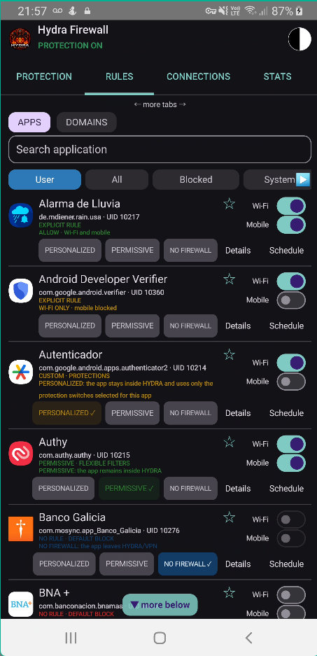
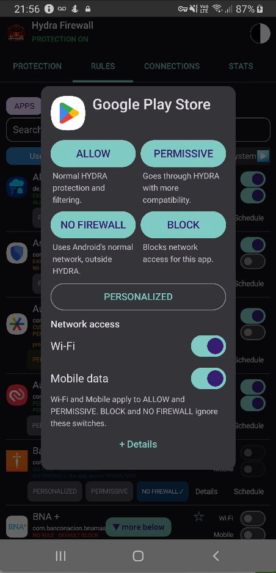
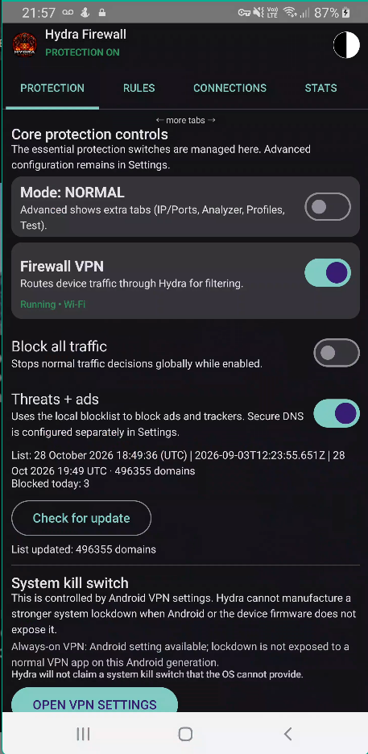
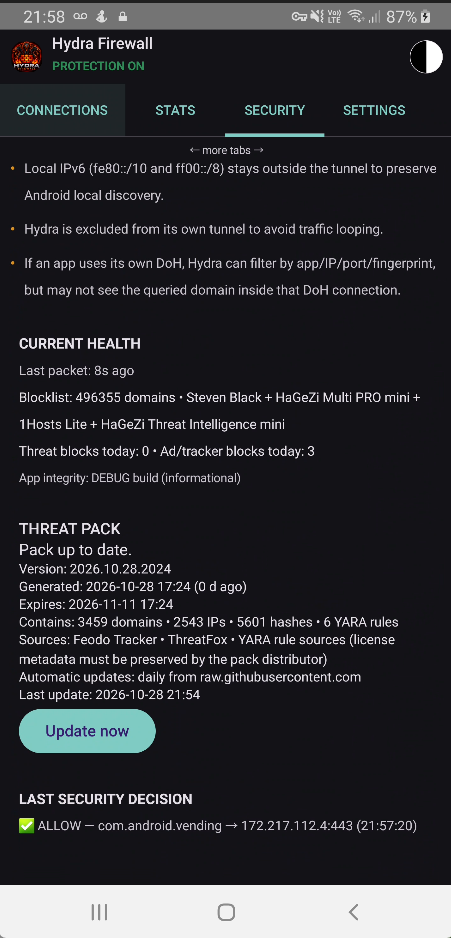
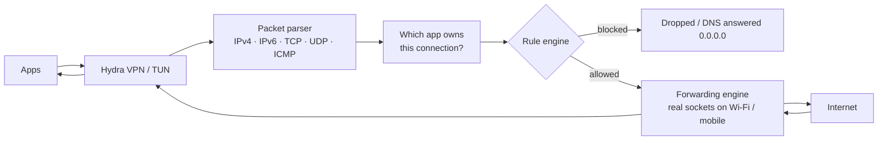

# Hydra Firewall

**A per-app firewall for Android 7.0+. No root. No account. No telemetry.**

[](https://github.com/hydraroot/Hydra_Firewall/actions/workflows/android.yml)


🇪🇸 [Versión en español](README.es.md)

<p align="center">
  
  
  
  
</p>


> **Status: beta / pre-release validation** (version `3.6.7`, see [`docs/VERSIONING.md`](docs/VERSIONING.md)). Test it on a non-critical device before relying on it.
> **Hydra is a firewall, not an antivirus.** Read [What Hydra does NOT do](#what-hydra-does-not-do) before relying on it.

---

## Summary

Hydra runs as a **local VPN on your phone**. Every packet your apps send goes through Hydra first,
and Hydra decides — per app, and separately for Wi‑Fi and mobile data — whether it may leave the
device. On top of that it filters ads, trackers and known-malicious domains/IPs, and gives you
visibility into what each app is contacting and which recorded policy decision allowed or blocked it.

Everything runs **on the device**. There are no Hydra servers, no account and no analytics.

| | |
|---|---|
| **What it is** | An Android firewall built on the system `VpnService` (TUN interface). Open source, GPL‑3.0‑or‑later. |
| **What it does** | Per-app Wi‑Fi/mobile rules · first-connection prompts · new-app quarantine · ad/tracker/malware domain blocking · encrypted DNS · SNI/QUIC filtering without decrypting HTTPS · IP and port rules · signed threat-intelligence pack · APK scanner and app-risk scoring · local behavior analysis · connection history and statistics · PIN/biometric lock · six selectable visual themes · config export/import |
| **What it does not do** | Detect malware reliably · decrypt HTTPS · replace Android's own security · block traffic of apps you excluded from the VPN · work together with another VPN |
| **Privacy** | No telemetry. The only network requests Hydra makes on its own are listed in [Updates and network activity](#updates-and-network-activity). |
| **Requirements** | Android 7.0+ (API 24). Android allows only one active VPN at a time. |
| **Cost / license** | Free. GPL‑3.0‑or‑later. Third-party data and libraries are listed in [Third-party components](#third-party-components-and-licenses). |

<!--GALLERY-->

## Table of contents

1. [How it works](#how-it-works)
2. [Features](#features)
3. [Updates and network activity](#updates-and-network-activity)
4. [What Hydra does NOT do](#what-hydra-does-not-do)
5. [Quick start](#quick-start)
6. [Install or build](#install-or-build)
7. [FAQ](#faq)
8. [Documentation index](#documentation-index)
9. [Third-party components and licenses](#third-party-components-and-licenses)
10. [Security, contributing, license](#security-contributing-license)

## How it works

Android lets an app create a VPN interface without root. Hydra creates one, asks Android to route
the phone's traffic into it, and then implements its own small network stack in user space.



1. **Capture.** Android sends the traffic of every non-excluded app to Hydra's TUN interface.
2. **Identify.** Hydra works out which app owns each connection (system API on newer Android, `/proc/net` on Android 7–9). If it cannot tell, the connection is dropped — it never guesses.
3. **Decide.** The rule engine combines the app's rule, the network type (Wi‑Fi / mobile), global mode, schedules, IP and port rules, DNS/SNI matches, and the threat pack.
4. **Forward or drop.** Allowed traffic is re-sent through real sockets bound to the physical network; replies are rebuilt into IP packets and handed back to the app.

A deeper explanation (routing, DNS handling, TLS/QUIC inspection, limits) is in
[`docs/HOW-IT-WORKS.md`](docs/HOW-IT-WORKS.md).

## Features

Short overview below. Every feature is explained in detail in [`docs/FEATURES.md`](docs/FEATURES.md).

### Control who can connect
- **Per-app rules** for Wi‑Fi and mobile data independently: *Allow*, *Block*, *Permissive*, *Personalized* and *No firewall*.
- **First-connection prompt.** New apps start blocked and Hydra asks: allow, allow for 10 minutes, 1 hour, always, or block. A *Details* view explains why the app is connecting.
- **New-app quarantine** (optional, **off by default**; enable it in *Security → Quarantine*). Apps installed *after* you enable it are blocked from the network until you review them, and Hydra shows their risk score. Apps already on the phone are not affected. It is useful mainly if you let new apps connect by default; with the default settings (new apps start blocked and ask) it is redundant.
- **Global mode** (blacklist or whitelist), default Wi‑Fi/mobile decision, schedules, roaming and screen-off rules, and an emergency **Block all** switch.
- **IP blocking and port rules** (advanced mode) by protocol, address and port.

### Filter what they connect to
- **Ad/tracker and network-threat blocking**, ON by default through one **Threats + ads** master switch; includes a bundled list plus live HaGeZi, 1Hosts and StevenBlack lists, with signed threat-pack domain/IP indicators.
- **Automatic list refresh** about every 24 hours on unmetered physical networks; new lists are applied in memory without restarting the VPN. Manual check/update remains available.
- **Encrypted DNS** over DNS‑over‑TLS (with DNS‑over‑HTTPS fallback) using Cloudflare, Google or Quad9.
- **HTTPS filtering by server name (SNI)** — without decrypting anything.
- **QUIC / HTTP3** filtering on a best-effort basis by correlating with the DNS answer the same app got earlier.
- **Local-network and IPv6 controls**, including a *Block IPv6* switch.
- **Signed threat-intelligence pack** (malicious IPs/domains from sources such as Feodo Tracker and URLhaus, plus YARA‑Lite rules). It is installed only if its signature verifies.

### Understand your apps
- **Connection history and live analyzer**: app, destination, protocol, port, decision and time. Connection Details shows the policy branch and match data recorded at decision time; older entries may not contain an exact cause.
- **Usage insights**: per-app traffic ranking (session / today / 7 days) with flags such as "uploads more than it downloads".
- **APK scanner and APP RISK score** (0–100): permissions, exported components, accessibility/overlay/device-admin capabilities, native libraries, signing certificates.
- **Behavior engine**: correlates connections, DNS and blocks into a per-app behavior score, using only metadata Hydra already sees.
- **On-device models** (a small MH‑100K-trained model and two lightweight heuristic models) used only as *secondary signals* that warn — they never block by themselves. See [What the built-in AI does](#what-the-built-in-ai-does).
- **System-app safety labels** (high risk / caution / undetermined) before you block a system component.
- **Diagnostics** you can read over ADB on debug builds (release builds keep no connection log).

### Protect Hydra itself
- **PIN** of **5 to 8 digits** (PBKDF2, 120,000 iterations). **Fingerprint unlock is optional and OFF by default**; it becomes available only after Protect app with PIN is enabled. Wrong attempts add growing delays (15 s up to 5 min) that survive restarts and cannot be shortened by changing the phone's clock. PINs of 4 digits created by older versions keep working until you change them. `allowBackup=false`.
- **Tamper and recovery monitoring**: a notification and a card when the VPN stops by itself, Doze correlation (Advanced), restart after boot. Redundant IP/port rules are cleaned up in *Apps → IP and ports → Cleanup* (Advanced).
- **Configuration export/import** (rules, schedules, advanced rules, IP exceptions) as a file that is portable by app name, with automatic undo.
- **Normal and Advanced mode**, English/Spanish UI, six visual themes with light/dark/system appearance, battery options. **Normal mode is deliberately simple**: Security is one screen (status, suspicious apps with a plain-language reason, quarantine, update watch and security history), the first-connection prompt has just *Allow* / *Block* (everything else under *More options*), and Settings shows only the basics. A short first-run guide explains the three things that matter. **Advanced mode** adds IP and ports, Profiles, the Analyzer, the experimental APK scanner, traffic correlation, Doze and the technical settings.

## Updates and network activity

Hydra has **no telemetry**. Since 1.3.0 it can check for (and download) new versions of itself from this repository's GitHub Releases; **Android always asks you to confirm the install**, and Hydra only accepts an APK whose SHA‑256 matches the published one and which is signed with the same key as the installed app. You can turn the automatic check off in Security → Overview. The only connections the app makes on its own are:

| What | When | Where |
|---|---|---|
| **Signed threat pack** | Automatically about once every 24 h (inexact alarm), or on demand with *Update now* in Security Center. The default build points to this repository's `threat-pack` branch. | `raw.githubusercontent.com` |
| **Hydra updates** | About once a day (and when you tap *Check for update*): asks the GitHub API for the latest release; downloads the APK only on unmetered networks. | `api.github.com`, `github.com` releases |
| **Antivirus app checks** | Local only, no network: when an app is installed/updated and after each pack update, installed apps are compared with the downloaded pack. Can be turned off in Security → Overview. | — |
| **Ad/tracker and threat domain lists** | Checks for changes about every 24 h on unmetered physical networks; *Check for update* and *Update now* are also available. New lists are applied in memory without restarting the VPN. | GitHub raw (HaGeZi, 1Hosts, StevenBlack) |
| **Encrypted DNS** | Continuously, to resolve names. | Cloudflare / Google / Quad9 (your choice) |

How the threat pack is protected:

- It is accepted **only if its ECDSA P‑256 / SHA‑256 signature verifies** against the public key compiled into the app; tampered packs are discarded.
- The feed must use `https://`, and downloads are capped at 20 MB.
- Threat-pack, blocklist and app-update downloads use an explicitly selected **physical network** outside Hydra's tunnel. If none is available, they fail closed instead of falling back to the process default network. Redirects are limited to three HTTPS hops on that same network.
- Packs published by the workflow expire after 14 days; an expired pack is ignored and the bundled one is used. The pack bundled inside the APK is only a minimal seed (no expiry, almost no indicators): real protection comes from the downloaded pack.
- You can verify a published pack yourself: `python tools/verify_threat_pack.py <file or URL>`.

Lists are downloaded straight from their authors to your phone; Hydra does not mirror them
(see [`THIRD_PARTY_NOTICES.md`](THIRD_PARTY_NOTICES.md)).

Permissions requested:

| Permission | Why |
|---|---|
| `INTERNET`, `ACCESS_NETWORK_STATE` | Forward allowed traffic, update the threat pack, detect Wi‑Fi vs mobile data |
| `FOREGROUND_SERVICE`, `FOREGROUND_SERVICE_SYSTEM_EXEMPTED` | Keep the VPN service alive with its notification |
| `QUERY_ALL_PACKAGES` | List installed apps (names and icons) to apply per-app rules |
| `PACKAGE_USAGE_STATS` | Local usage statistics only |
| `POST_NOTIFICATIONS` | First-connection prompts and alerts |
| `RECEIVE_BOOT_COMPLETED` | Restart protection after the phone boots |
| `USE_BIOMETRIC` (`USE_FINGERPRINT` only up to Android 9) | Fingerprint unlock |
| `REQUEST_INSTALL_PACKAGES` | Install a new Hydra version you downloaded through the in-app update (Android still asks you to confirm). Only used by that feature |


## What Hydra does NOT do

- **It is not an antivirus.** The APK scanner is static and heuristic. The MH‑100K model is a
  secondary signal: at threshold 0.5 its own report shows ~64 % precision and 5.6 % false positives
  on legitimate apps. The "AI Lite" model was trained on synthetic data and is not evidence of real detection.
- **It does not decrypt HTTPS.** Filtering is by domain name (SNI) or IP. Apps with their own DoH,
  ECH, or hard-coded IPs can bypass domain filtering. QUIC/HTTP3 is covered only indirectly.
- **"Block all" is not a full kill switch.** It blocks traffic that enters Hydra's tunnel. Hydra
  itself and apps set to *No firewall* / excluded (compatibility mode) stay outside the tunnel and
  are not blocked. For a hard cutoff use Android's *Always-on VPN* + *Block connections without VPN*.
- **One VPN at a time** (Android limitation). Malware with root/system privileges can ignore the VPN.
- **Performance:** forwarding runs in user space, so expect more battery use and some latency
  compared with a native firewall. TCP has one shared 512-session budget across IPv4/IPv6; UDP allows 256 sessions per family and shares a 16 MiB / 4,096-datagram upstream queue budget.
  IPv6 does not have full parity (ESP and unsupported extension headers are rejected).
- **Android 7–9** identify the owning app through `/proc/net`, which can fail transiently; such
  connections are dropped (*fail closed*) and re-resolved in the background.
- **The PIN protects Hydra's screen, not the phone.** Someone with root, ADB or access to Android Settings can still stop the VPN or clear Hydra's data without the PIN. For stronger protection use Android's screen lock and *Always-on VPN* + *Block connections without VPN*.
- **Excluded apps are invisible to Hydra.** It cannot see or filter traffic that never enters the tunnel.
- **New apps start blocked,** so expect to approve apps the first time they connect.

Full list: [`docs/LIMITATIONS.md`](docs/LIMITATIONS.md).

The **"Threat intelligence (0 domains)"** row can start at zero on a fresh install until the first successful automatic background refresh on an unmetered physical network, or a manual list update. This is separate from the bundled ad/tracker list, which is active from the first run; both network layers share the **Threats + ads** master switch.

## What the built-in AI does

Hydra includes three very small models that run **entirely on your phone** (no cloud, no data leaves the device). None of them can block an app or change a rule: they only add a **warning score** that you see in Security Center and in app details.

| Model | What it looks at | What you get |
|---|---|---|
| **APK static model (MH‑100K)** | An APK you scan: permissions, API calls and intents found in its code | A 0–100 score for "looks like known Android malware". Precision is only about 64 % at threshold 0.5 and 5.6 % of legitimate apps are flagged, so Hydra calls 50–89 *doubtful* and only 90+ *suspicious* (about 81 % precision, 2 % false positives). |
| **Behavior model ("AI Lite")** | Per-app connection metadata: number of destinations, DNS blocks, unusual ports, TLS alerts, bursts | A behavior risk level. It was trained on synthetic data, so it is **not** evidence of real detection. |
| **Privacy model** | Per-app tracker-like behavior: many new destinations, blocked DNS queries, SNI blocks | A privacy/tracking signal. It never labels an app as malware. |

Each score comes with one plain result: **0–49 looks normal, 50–89 doubtful, 90–100 suspicious** (the higher, the more suspicious), based on how often the model was right at that score in testing. If too little of the app's code could be analyzed, the result is **no conclusion**.

**Antivirus-style protection (since 1.2.0).** Hydra checks your installed apps against the signed threat pack (known-malware SHA‑256 hashes + YARA‑Lite patterns) when an app is installed or updated and after every pack update (and when you open the app or on the daily pack check, even with the VPN off; instant detection on install needs the VPN on), and notifies you of matches. It only detects *known* threats, never removes anything by itself, and does not replace Google Play Protect. **Security → Overview → "Control and updates"** lets you manage the VPN and antivirus; network threat blocking and ad/tracker filtering share the single **Threats + ads** master switch on Protection.

Together with the YARA‑Lite rules, and the signed threat pack, they feed **Security Center** so you can decide with more information. The decision is always yours.

## Quick start

1. **Install** the APK (see below) and open Hydra.
2. Tap the **Firewall VPN** switch on the Home screen and accept Android's VPN prompt.
3. Allow notifications and exclude Hydra from battery optimization (otherwise Android may stop the service).
4. Use your phone normally. Each app that connects for the first time triggers the **first-connection prompt** — choose *Allow* or *Block* (tap *More options* for the rest).
5. Open **RULES** to review per-app Wi‑Fi/mobile switches, **CONNECTIONS** to see history, and **SECURITY** for the threat pack and app scanning.
6. Optional: set a **PIN**, enable **Always-on VPN** in Android settings.

Before reinstalling Hydra, use **Export** (Settings/Profiles) to save your configuration, then **Import** it afterwards.

## Install or build

**Just want to try it?** Download the APK from the [Releases](https://github.com/hydraroot/Hydra_Firewall/releases) page.
You may need to allow "install unknown apps", and Play Protect may warn because the app is distributed outside the Play Store.
Check the SHA‑256 shown in the release notes.

**Build from source** — JDK 17 and the Android SDK (or Android Studio). Full guide: [`docs/BUILD.md`](docs/BUILD.md).

```bash
./build.sh install      # tests + debug APK + adb install
./build.sh release      # release APK (signed if you configured a keystore)
```

Windows: `BUILD-AND-INSTALL.ps1`. GitHub Actions (`.github/workflows/`) runs Android and Python tests on every push/PR and uploads a debug APK. A `vX.Y.Z` tag creates a signed GitHub Release when the signing secrets are configured.

> The Google Play application ID for this release is `com.hydra.firewall`, matching the app created in Play Console. Keep it unchanged for future updates. Older local builds using `com.hydraroot.firewall` or `com.example.firewall` are treated as different apps; export your settings from an older build before switching and import them into this release.
>
> Debug APKs built by GitHub Actions are signed with a temporary key that changes every run, so they cannot update an installed app. Use the **signed** APK instead (artifact `hydra-release-apk`, built when the signing secrets are configured): it installs as an update over the previous version without uninstalling. See [`docs/VERSIONING.md`](docs/VERSIONING.md).

## FAQ

**Does Hydra see my traffic?** It sees packet metadata (app, destination IP, port, DNS names, TLS server name) to apply rules. It does not decrypt HTTPS and it does not upload anything.

**Why is an app suddenly without internet?** New apps start blocked. Open **CONNECTIONS → Details** to see the exact policy reason saved when Hydra evaluated the attempt (new records only; older entries may not retain it), then check the app's rule, the Wi‑Fi/mobile switches, schedules and global settings.

**Why does an app with *No firewall* still connect during Block all?** Apps outside the tunnel are not seen by Hydra. See the limitation above.

**Can I use Hydra with another VPN?** No. Android allows one active VPN.

**Does it drain the battery?** Forwarding in user space costs more than a native firewall. Low-power options exist in Settings.

**Is the AI a malware detector?** No. The on-device models are secondary signals that warn; they never block automatically.

**How do I know a threat pack is genuine?** The app verifies an ECDSA signature before installing it. You can verify it yourself with `tools/verify_threat_pack.py`.

## Documentation index

| Document | What it covers |
|---|---|
| [`docs/FEATURES.md`](docs/FEATURES.md) | Every feature explained in detail |
| [`docs/HOW-IT-WORKS.md`](docs/HOW-IT-WORKS.md) | Architecture: routing, packet pipeline, DNS, TLS/QUIC, limits |
| [`docs/LIMITATIONS.md`](docs/LIMITATIONS.md) | What Hydra does and does not guarantee |
| [`docs/THREAT-PACK.md`](docs/THREAT-PACK.md) | Signed threat packs: keys, feeds, verification |
| [`docs/BUILD.md`](docs/BUILD.md) | Build, sign and install; key backups; migration |
| [`docs/VERSIONING.md`](docs/VERSIONING.md) | Version scheme (1.0.x / 1.x.0 / x.0.0) and in-place updates |
| [`SECURITY.md`](SECURITY.md) | How to report a vulnerability |
| [`CONTRIBUTING.md`](CONTRIBUTING.md) | How to contribute |
| [`TRADEMARK.md`](TRADEMARK.md) | Use of the Hydra Firewall / Hydraroot names and logo |
| [`CHANGELOG.md`](CHANGELOG.md) | Version history (Spanish) |
| [`THIRD_PARTY_NOTICES.md`](THIRD_PARTY_NOTICES.md) | Third-party data, libraries and licenses |
| [`docs/es/`](docs/es/) | Spanish versions of the guides above |

## Third-party components and licenses

Hydra itself is **GPL‑3.0‑or‑later** (see [`LICENSE`](LICENSE)). It builds on the following; full
details, attribution and exclusions are in [`THIRD_PARTY_NOTICES.md`](THIRD_PARTY_NOTICES.md).

**Libraries (linked into the APK)**

| Component | License |
|---|---|
| Kotlin / Kotlin stdlib | Apache‑2.0 |
| AndroidX (core‑ktx, activity‑compose, lifecycle, fragment, appcompat, biometric) | Apache‑2.0 |
| Jetpack Compose (BOM, ui, material3, foundation) | Apache‑2.0 |
| kotlinx.coroutines | Apache‑2.0 |
| JUnit 4, org.json (tests only, not shipped) | EPL‑1.0 / public domain |

**Data bundled inside the APK**

| Data | License / author |
|---|---|
| Ad/tracker blocklist: Steven Black ad-hoc list, FadeMind hosts.extras, Badd‑Boyz‑Hosts, hostsVN | MIT |
| Ad/tracker blocklist: AdAway (© Kicelo, Dominik Schuermann and contributors), Tiuxo hostlist | CC BY 3.0 / CC BY 4.0 — attribution required |
| Ad/tracker blocklist: minecraft‑hosts | CC0‑1.0 |
| Public root CA certificates (DigiCert Global Root CA, DigiCert Global Root G2, ISRG Root X1, ISRG Root YR), used only as an additive fallback for HTTPS updates on old Android | CA public certificates |
| On-device model trained from the **MH‑100K Android Malware Dataset** (hendriow/mh100k) — the dataset itself is not bundled | CC BY 4.0 — see [`docs/reference/MH100K-ATTRIBUTION.md`](docs/reference/MH100K-ATTRIBUTION.md) |

**Data downloaded by the phone at your request (not redistributed in the APK)**

| Source | License |
|---|---|
| HaGeZi Multi PRO mini, HaGeZi Threat Intelligence mini | GPL‑3.0 |
| 1Hosts Lite | MPL‑2.0 |
| StevenBlack unified hosts (optional) | MIT (aggregates sources with their own terms) |
| OISD (optional) | terms to confirm before use |
| abuse.ch — Feodo Tracker, URLhaus, ThreatFox (through the signed pack) | CC0 |

**Services used:** Cloudflare, Google and Quad9 encrypted DNS resolvers (operated by those
companies under their own terms and privacy policies).

This section is a good-faith summary, not legal advice. Trademarks belong to their owners.

## Trademark

The code is free software (GPL‑3.0‑or‑later) and anyone may fork it. The **names "Hydra Firewall" and
"Hydraroot" and the logo are not licensed with the code**. If you publish a modified version, give it
a different name, logo and `applicationId`, and do not present it as the official app.
See [`TRADEMARK.md`](TRADEMARK.md).

## Security, contributing, license

- Found a vulnerability? Please **do not open a public issue** — see [`SECURITY.md`](SECURITY.md).
- Want to contribute? See [`CONTRIBUTING.md`](CONTRIBUTING.md).
- GPL‑3.0‑or‑later © 2026 Hydraroot / WDS657. See [`LICENSE`](LICENSE).
