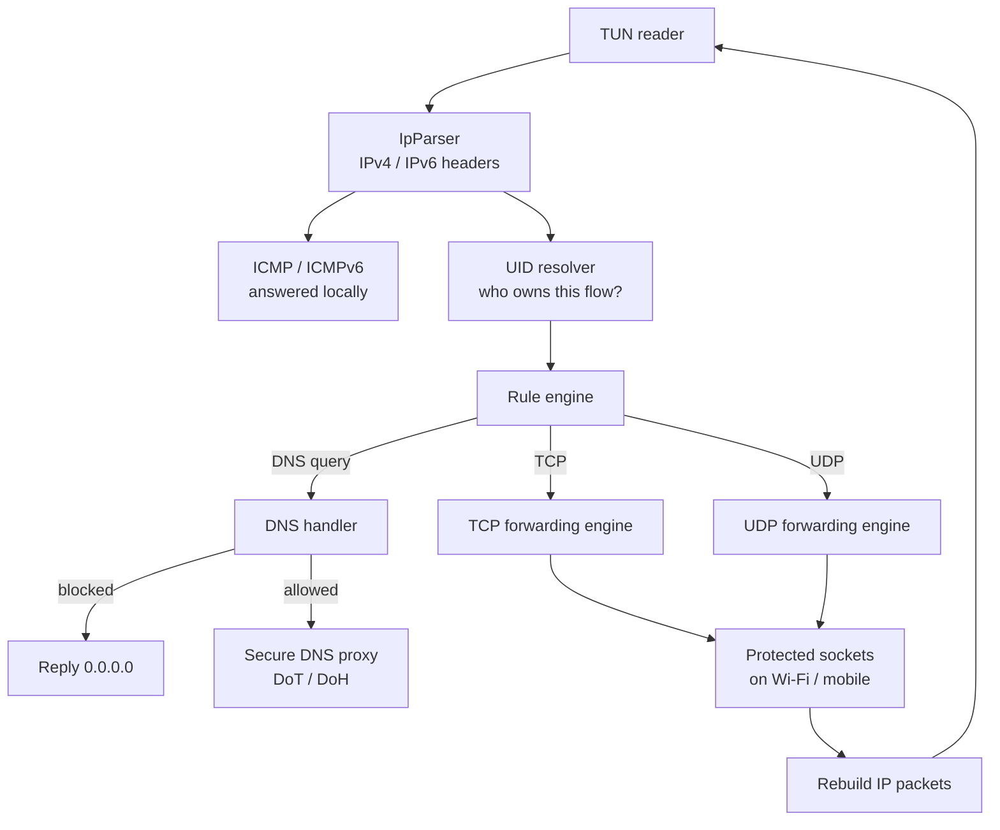
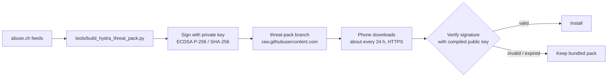

# How Hydra works

This document explains the architecture of Hydra Firewall: how traffic reaches the app, how a
decision is made, and where the technical limits come from. For features see
[FEATURES.md](FEATURES.md).

## 1. The VPN trick

Android allows any app to create a **VPN interface** (`VpnService`, a TUN device) without root. Hydra
builds one and tells Android which destinations should be routed into it. Packets that follow those
routes reach Hydra as raw IP packets; everything else (and the apps you excluded) uses the normal network.

Routes Hydra asks for:

| Traffic | Routed into Hydra |
|---|---|
| IPv4 | everything (`0.0.0.0/0`) |
| IPv6 global unicast | `2000::/3` |
| IPv6 unique-local | `fc00::/7` |
| NAT64 | `64:ff9b::/96` and `64:ff9b:1::/48` |
| IPv6 link-local / multicast | **not routed** — intentionally left to Android for local discovery |

Excluded from the tunnel: Hydra itself and apps set to **No firewall** (`addDisallowedApplication`).

Because Android decides what enters the tunnel, Hydra only controls what Android routes to it. Always-on
VPN and Lockdown are features of Android's VPN framework, not of Hydra.

## 2. The packet pipeline



1. **TUN reader** reads one IP packet at a time from the VPN interface.
2. **Parser** decodes IPv4/IPv6 and the transport header (TCP, UDP, ICMP). IPv6 fragments are reassembled; unsupported extension headers and ESP are rejected.
3. **UID resolver** finds which app owns the flow. On newer Android it asks the system; on Android 7–9 it reads `/proc/net`, which can fail transiently. Hydra retries briefly in the packet thread, and the rest of the retries happen in the background. **If the owner cannot be determined, the connection is dropped.** Hydra does not infer the app from the destination IP, because an IP can be shared by many apps and CDNs.
4. **Rule engine** produces *allow* or *block* combining the app's mode, the network type, global mode, schedules, advanced IP/port rules, blocklists, threat pack, SNI/JA3 and QUIC protection.
5. **Forwarding engines** implement a small TCP/UDP stack in user space: they keep a session table, handle TCP sequence numbers and reassembly, open real sockets that are *protected* (they bypass the VPN so they do not loop), and rebuild reply packets with correct checksums.

### Backpressure
TCP packets waiting for the engine thread are held in a bounded queue (2048 packets / 4 MB). When it is
full, new packets are dropped and TCP retransmission recovers. The engine also processes packets in
batches so timers and sockets keep being served under load. Nominal capacity is 768 simultaneous
sessions (TCP 128+128, UDP 256+256).

## 3. DNS handling

- Hydra looks at DNS queries (UDP/53). A name that matches the blocklist, a custom rule or the threat pack is answered locally with `0.0.0.0`.
- Allowed queries can be sent through the **secure DNS proxy**: DNS‑over‑TLS (port 853) by default, with DNS‑over‑HTTPS fallback, to Cloudflare, Google or Quad9. These sockets use the physical network.
- The DNS parser is iterative and bounded: compression pointers may only point backward, with a jump limit, so a malformed or malicious response cannot crash the engine.
- Hydra remembers **which app resolved which IP** (a short-lived correlation) so it can name destinations in history and apply domain rules to QUIC. This correlation is used for *labels and domain rules*; it is never used to decide which app owns a connection.

## 4. TLS and QUIC inspection

- **TLS over TCP:** Hydra parses the TLS ClientHello to extract the server name (SNI) and, optionally, compute JA3 / JA3N / HYDRA-lite fingerprints. It does not decrypt.
- **QUIC / HTTP3:** the handshake is encrypted differently, so inspection is best effort: Hydra correlates QUIC flows with the DNS answer the same app got earlier and applies domain rules to that.
- Things that hide names from Hydra: apps with their own DoH, Encrypted Client Hello (ECH) and hard-coded IPs.

## 5. Signed threat pack



The private key never ships with the app. The public key is compiled into it, and a unit test checks
that the key used by the build and the verifier's default key are the same.

## 6. Security Engine data flow

All analysis is local. The APK scanner reads an APK or an installed app and produces indicators and a
risk score. The behavior engine reads Hydra's own connection and DNS metadata. YARA‑Lite rules and the
small on-device models add secondary signals. Results become *security events* and the *security status*
shown in the Security tab. None of it changes the network policy by itself.

## 7. Project layout

```
app/src/main/java/com/hydra/firewall/
  vpn/         Network engine: TUN service, parsers, TCP/UDP/ICMP engines, DNS, rules, stores
  security/    APK scanner, YARA‑Lite, models, risk engines, signed threat packs, updater
  *.kt         Compose UI: Main, Security Center, Help, Lock, config transfer, prompt activity
tools/         Python: threat-pack generator/signer/verifier, model training, blocklist builder
docs/          Guides and references
```

## 8. Why there are limits

- It is a **user-space** stack, so it costs more CPU/battery than a kernel firewall.
- It only sees what Android routes into the tunnel.
- It sees metadata, not encrypted content.
- Only one VPN can be active, and a process with root or system privileges can ignore it.

See [LIMITATIONS.md](LIMITATIONS.md) for the full list.
